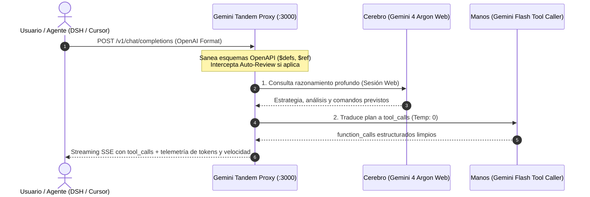

# 🚀 Gemini Tandem Proxy

> Conecta tu suscripción de **Google AI Pro (Gemini 4 Argon)** a **DeepSeek Harness, Cursor, Claude Code, Cline, Roo Code** o cualquier cliente compatible con la API de OpenAI, con **Tool Calling nativo**, telemetría en tiempo real y persistencia de conversación.

[](https://nodejs.org/)
[](LICENSE)
[-orange.svg)]()

---

## 💡 ¿Qué problema resuelve?

Los suscriptores de **Google One AI Pro** tienen acceso a **Gemini 4 Argon**, el modelo de razonamiento más profundo de Google en la web. Sin embargo:
1. **Google no ofrece una API estándar de OpenAI** para usar Argon en agentes de código (DeepSeek Harness, Cursor, Cline, etc.).
2. La interfaz web de Gemini responde con explicaciones en lenguaje natural, **no emite `tool_calls` estructurados en formato OpenAI**.
3. Los esquemas Pydantic / OpenAPI generados por los agentes contienen `$defs`, `$ref`, `allOf` o `additionalProperties` que rompen las APIs de Gemini.
4. Entornos como DeepSeek Harness (`Auto review EXP`) interceptan las herramientas esperando un JSON estricto de aprobación; si el modelo responde en texto, la ejecución se aborta.
5. Cada petición a la web de Gemini normalmente abre un chat nuevo, inundando tu historial.

**Gemini Tandem Proxy** resuelve todo esto automáticamente mediante una **Arquitectura en Tándem** local de cero dependencias.

---

## 🧠 Arquitectura en Tándem



1. **El Cerebro (Gemini 4 Argon):** Piensa a máxima profundidad mediante tu sesión de Google AI Pro.
2. **Las Manos (Gemini Flash a Temp 0):** Traduce con precisión quirúrgica el plan de Argon en llamadas de herramientas reales (`run_command`, `write_to_file`, `pwsh`, etc.).

---

## ✨ Características Principales

* 🛡️ **Saneador de Esquemas OpenAPI:** Resuelve recursivamente referencias `$defs` y `$ref`, limpia `additionalProperties`, fusiona `allOf` y normaliza tipos unión para garantizar compatibilidad del 100%.
* ⚡ **Interceptor Nativo de Auto-Review:** Aprueba automáticamente solicitudes `REVIEW_POLICY` de DeepSeek Harness (`@deepseek-ai/dsh-experimental-auto-review`) con el formato JSON estricto requerido (`{"risk":"low","decision":"allow"}`), eliminando bloqueos de permisos.
* 💬 **Persistencia de Hilo Continuo:** Reutiliza `conversationId` y `responseId` de Google Web para trabajar siempre dentro del mismo chat, manteniendo el historial limpio en tu cuenta.
* 📊 **Telemetría y Micro-Streaming Real:** Emite deltas de texto con cadencia regular para que DeepSeek Harness o Cursor calculen métricas en tiempo real (`tok/s`, caché y ventana de 2,000,000 tokens).
* 🔄 **Modo de Contingencia Transparente:** Si la sesión web de Google rota o expira, el proxy conmuta en caliente a la API oficial e inserta un banner de aviso visible en el chat para máxima honestidad.
* 🪟 **Saneador de Comandos Shell:** Filtra prosa en lenguaje natural dentro de argumentos de PowerShell o Bash para prevenir errores de sintaxis (`Unexpected token`).
* 📦 **Cero Dependencias:** Construido exclusivamente con módulos nativos de Node.js (`node:http`, `node:https`, `node:fs`, `node:crypto`).

---

## 🚀 Guía de Inicio Rápido

### 1. Clonar el repositorio
```bash
git clone https://github.com/rowehans/gemini-tandem-proxy.git
cd gemini-tandem-proxy
```

### 2. Configurar tus credenciales
Copia la plantilla de entorno:
```bash
cp .env.example .env
```

Edita `.env` con tus datos:
```ini
# Sesión Web de Google AI Pro (Gemini 4 Argon)
GEMINI_PSID="tu-__Secure-1PSID"
GEMINI_PSIDTS="tu-__Secure-1PSIDTS"

# Clave gratuita de Gemini API para Las Manos
GEMINI_API_KEY="tu-gemini-api-key"

PORT=3000
```

#### ¿Cómo obtener tus cookies de Gemini Web en 20 segundos?
1. Inicia sesión en [gemini.google.com](https://gemini.google.com) con tu cuenta de Google AI Pro.
2. Presiona `F12` (o clic derecho -> **Inspeccionar**).
3. Ve a la pestaña **Application** (o **Aplicación** / *Almacenamiento*).
4. En el panel izquierdo, despliega **Cookies** y haz clic en `https://gemini.google.com`.
5. Copia el valor de:
   * **`__Secure-1PSID`**
   * **`__Secure-1PSIDTS`**

#### ¿Cómo obtener tu API Key para Las Manos?
1. Entra a [Google AI Studio](https://aistudio.google.com/app/apikey).
2. Genera una clave API gratuita y pégala en `GEMINI_API_KEY`.

---

### 3. Iniciar el Servidor
```bash
npm start
```
El proxy iniciará en:
```text
[TÁNDEM ACTIVO] Cerebro (Argon Máx.) + Manos (Gemini Flash Tool Caller) listo en http://127.0.0.1:3000/v1
```

---

## 🔧 Configuración en tus Clientes

### En DeepSeek Harness (`dsh`)
En tu archivo de perfil (`cordis.patch.yml`):
```yaml
- id: agent-default-model
  name: "@deepseek-ai/dsh-agent-default-model"
  config:
    provider: gemini4argon
    model: gemini-4-argon

- id: llm-pi-ai
  name: "@deepseek-ai/dsh-llm-pi-ai"
  config:
    providers:
      gemini4argon:
        apiKeyEnv: GEMINI4ARGON_API_KEY
        api: openai-completions
        baseURL: http://127.0.0.1:3000/v1
        models:
          - id: gemini-4-argon
            name: gemini-4-argon
```
> **Consejo:** En el menú de permisos de DeepSeek Harness, selecciona **Acceso total** para máxima autonomía.

### En Cursor / Cline / Roo Code / LibreChat
Configura un proveedor OpenAI personalizado:
* **Base URL:** `http://127.0.0.1:3000/v1`
* **API Key:** cualquier texto (ej. `local`)
* **Model ID:** `gemini-4-argon`

---

## 🧪 Pruebas Automatizadas

El proyecto incluye suites completas de verificación:
```bash
# Validar saneador de esquemas y auto-review
npm test

# Ejecutar suite completa con streaming y E2E
npm run test:all
```

---

## 📄 Licencia

Distribuido bajo la licencia [MIT](LICENSE). Creado para la comunidad de desarrolladores y usuarios de Google AI Pro.
